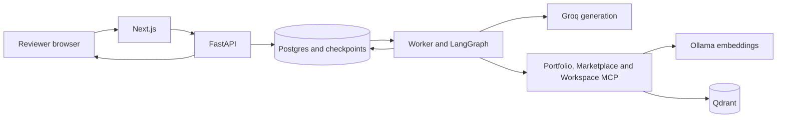

# GigBid

> The 30-second demo GIF and recording link will be added after the demo is recorded.

GigBid helps freelancers decide which jobs to pursue and draft proposals grounded in their portfolio. Every outgoing action goes through human review of the exact draft, destination, bid and Connects cost.

- **Review deployment.** Vercel frontend, Render API and Neon Postgres. [API readiness](https://gigbid-dari.onrender.com/ready) was verified. The production frontend URL and hosted worker still need final reviewer verification.
- **Data.** The historical instructor archive supplies job listings for selected accounts. Mock clients, submission effects and Connects accounting are simulated. Keep the raw archive private. [Data card](docs/DATA_CARD.md)
- **Local release checks.** 217 Python tests passed with one Postgres checkpoint skip, and nine Chrome journeys passed. With Groq and local Ollama V2 over MCP HTTP, 28 of 30 repeated mock proposals submitted and 29 of 30 replies sent. [Smoke report](evals/results/smoke-20261115-162627.json)

## Architecture



The bid graph analyses job requirements, risk and evidence in parallel, then joins the results for a decision. Drafts pass verification, critique, compliance and dry-run review before a persisted approval. The conversation graph keeps a durable thread for each client and requires approval before a reply is sent.

See the [bid graph](docs/images/bid.mmd), [conversation graph](docs/images/conversation.mmd) and [rendered graph sources](docs/GRAPH_DIAGRAMS.md). The worker and API share run state and checkpoints. Ollama generates embeddings and Qdrant stores vectors in the evaluated V2 configuration. Groq generates drafts. Hosted BM25, if selected, is a distinct configuration.

## Run locally

Start from a checkout with Python, uv, Node and Docker installed. Copy `.env.example` to a private `.env` and set a local Postgres password and the model configuration. Then run:

```sh
docker compose -f infra/docker-compose.yml up --build
```

Open `http://localhost:3000` and use **Settings → Load synthetic examples** to rehearse the mock workflows. See the [runbook](docs/RUNBOOK.md) for native Windows commands, model setup and backend checks. See the [Portfolio MCP server README](mcp_servers/portfolio/README.md) for installation and authenticated usage.

## Evaluation

<!-- results:start -->
Generated by `python -m evals.tables` from the newest results files. The dev set is synthetic and suitable for harness validation only; official conclusions wait for the official dev set and GigSim.

### Results table

| Variant | Evidence Recall@5 | nDCG@10 | Unsupported claims per proposal (before → after) | Judge score (1-5) | GigSim reply rate | p95 latency (s) | Median cost per proposal (USD) |
|---|---|---|---|---|---|---|---|
| V0 | 0.63 | 0.76 | 1.44 → 0 | 4.04 | pending (GigSim not released) | 63.00 | 0.0022 |
| Best (V2) | 0.75 | 0.81 | – | – | pending (GigSim not released) | – | – |

Source: `evals/results/retrieval-20261109-111100.json`, `evals/results/decisions-open-20261109-105854.json`

Proposal columns cover the 9 jobs drafted in the V0 run; the best row waits for its run. The V0 run came first, before the prompt fixes in the failure taxonomy; the best row uses the shipped configuration, so it also carries those fixes.

### Retrieval variants and pipelines

| Pipeline | Recall@5 | MRR | nDCG@10 | Refused when nothing fits | Refused with evidence | p95 ms |
|---|---|---|---|---|---|---|
| V2 | 0.75 | 0.89 | 0.81 | 0 | 0 | 99 |
| V0 | 0.63 | 0.85 | 0.76 | 0 | 0 | 495 |
| V8 | 0.63 | 0.85 | 0.76 | 0 | 0 | 113 |
| V3 | 0.62 | 0.81 | 0.76 | 0 | 0 | 5767 |
| V2+V3 | 0.62 | 0.81 | 0.76 | 0 | 0 | 108 |
| BM25 | 0.69 | 0.85 | 0.75 | 0 | 0 | 3 |
| V4 | 0.62 | 0.82 | 0.72 | 0 | 0 | 113 |
| V1+V2 | 0.62 | 0.82 | 0.71 | 0 | 0 | 915 |
| V1 | 0.59 | 0.81 | 0.70 | 0 | 0 | 837 |
| V1+V2+V3+V8 | 0.58 | 0.71 | 0.65 | 0.11 | 0 | 1237 |
| V1+V2+V3+V4 | 0.53 | 0.71 | 0.63 | 0 | 0 | 961 |
| V1+V3 | 0.53 | 0.69 | 0.63 | 0 | 0 | 34316 |
| V1+V2+V3 | 0.53 | 0.69 | 0.63 | 0 | 0 | 910 |

Source: `evals/results/retrieval-20261109-111100.json`

### Ablation of the best pipeline (V2)

| Removed | Pipeline | Recall@5 | nDCG@10 | nDCG@10 change |
|---|---|---|---|---|
| V2 | V0 | 0.63 | 0.76 | -0.0490 |

Source: `evals/results/retrieval-20261109-111100.json`

### Recall@5 and nDCG@10 by persona: V0 against V2

| Persona | Jobs | V0 Recall@5 | Best Recall@5 | V0 nDCG@10 | Best nDCG@10 |
|---|---|---|---|---|---|
| ai-ml | 14 | 0.66 | 0.78 | 0.75 | 0.81 |
| data-analyst | 14 | 0.62 | 0.76 | 0.80 | 0.85 |
| full-stack | 14 | 0.61 | 0.72 | 0.74 | 0.78 |

Source: `evals/results/retrieval-20261109-111100.json`

### Recall@5 and nDCG@10 by job type: V0 against V2

| Job type | Jobs | V0 Recall@5 | Best Recall@5 | V0 nDCG@10 | Best nDCG@10 |
|---|---|---|---|---|---|
| exact_tool | 9 | 0.63 | 0.77 | 0.85 | 0.94 |
| implied_skill | 6 | 0.67 | 0.88 | 0.89 | 0.94 |
| injection | 6 | 0.54 | 0.66 | 0.74 | 0.79 |
| low_budget | 3 | 0.50 | 0.56 | 0.51 | 0.52 |
| multi_requirement | 9 | 0.61 | 0.76 | 0.80 | 0.85 |
| out_of_scope | 0 | – | – | – | – |
| scam | 6 | 0.78 | 0.78 | 0.64 | 0.65 |
| vague | 3 | 0.63 | 0.77 | 0.67 | 0.73 |

Source: `evals/results/retrieval-20261109-111100.json`

### Hypotheses (recorded before the runs)

| Claim | Supported |
|---|---|
| V1+V2+V3 raises Recall@5 by at least 10 points over V0 on multi_requirement and exact_tool jobs | no |
| On implied_skill jobs V1+V3 scores at least as well as V1+V2+V3 | yes |
| V4 moves Recall@5 by less than 2 points | yes |
| Better retrieval does not change bid or skip decisions on implied_skill jobs | yes |

Source: `evals/results/retrieval-20261109-111100.json`

Evidence gate with V2 instead of V0: 0 of 51 jobs change; gold bid jobs passing {'V0': 33, 'V2': 33, 'of': 33}; 37 jobs had gold evidence retrieved but not counted because its skill tags lack the requirement.

### Decisions on every dev job (hand-built graph, production profile)

| Jobs | Errors | Bid accuracy | Bid F1 | Scam precision | Scam recall | Price in band | Unsupported before → after | Canary leaks | Blocked by compliance | Judge score | p95 s per job | Median USD per job |
|---|---|---|---|---|---|---|---|---|---|---|---|---|
| 51 | 0 | 0.92 | 0.94 | 0.67 | 1.00 | 0.69 | 1.44 → 0 | 0/0 | 3 | 4.04 | 56.10 | 0.0003 |

Source: `evals/results/decisions-open-20261109-105854.json`

Model comparison: not run yet; the deployed profile (gpt-oss-20b small nodes, gpt-oss-120b writer and critic) is used throughout.

Architecture study: pending.

### Tool granularity on 40 tasks (openai/gpt-oss-20b)

| Tool set | Tasks run | Tool selection accuracy | Argument accuracy | Tokens per task |
|---|---|---|---|---|
| fine | 40 | 0.82 | 0.80 | 938 |
| coarse | 40 | 0.78 | 0.75 | 929 |
| rewritten | 40 | 0.93 | 0.90 | 1431 |

Source: `evals/results/tools-20261114-120333.json`

Judge (qwen/qwen3.8-27b, prompt v1) against human labels: pending (0 of 30 items carry a label and a verdict). Source: `evals/results/judge-20261109-123142.json`.
<!-- results:end -->

### Multi-agent comparison status

| Design | Evidence available |
|---|---|
| Custom parallel LangGraph | Measured decision and smoke runs |
| Single ReAct agent | Runner exercised with scripted generation |
| Prebuilt supervisor | Runner exercised with scripted generation |

A matched real-model comparison remains pending. The synthetic data and test conditions are documented in the [evaluation guide](docs/EVALUATION.md).

## Review and submission

The trace exports below come from recorded runs and contain event names, node names, and status. They become public links when this revision is pushed to the public repository.

- [Skipped scam](docs/traces/skipped-scam.md)
- [Approved proposal](docs/traces/approved-proposal.md)
- [Critic revision loop](docs/traces/critic-loop.md)
- [Crash and resume](docs/traces/crash-and-resume.md)
- [Approved client reply](docs/traces/approved-reply.md)

See the [submission checklist](docs/SUBMISSION.md), [technical article draft](docs/TECHNICAL_WRITEUP.md), [requirements](docs/REQUIREMENTS.md), and [AI usage](docs/AI_USAGE.md). Judge calibration, official GigSim outcomes and the proposal experiment results remain pending.
