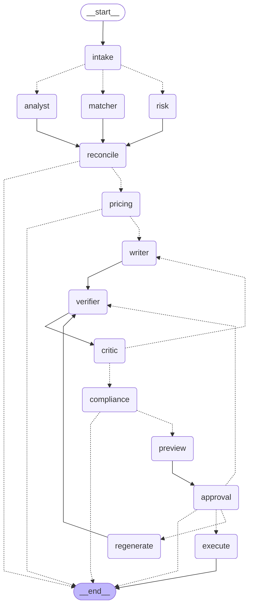
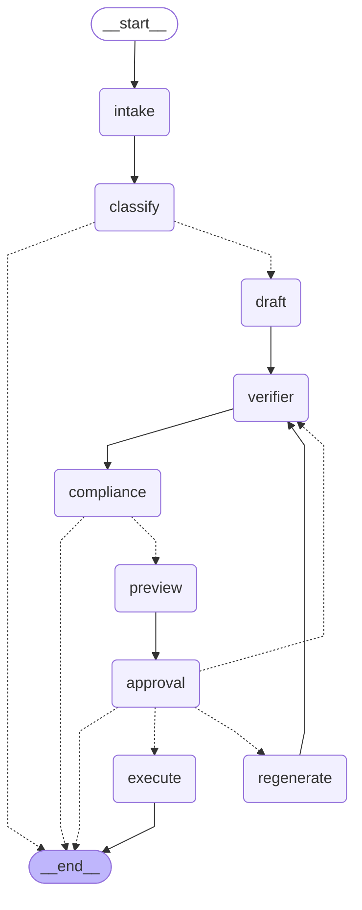

# GigBid graph diagrams

Generated from the LangGraph builders with `python -m scripts.graphs`.

[Bid graph SVG](images/bid-graph.svg) · [Conversation graph SVG](images/conversation-graph.svg)

## Bid graph

## Conversation graph

